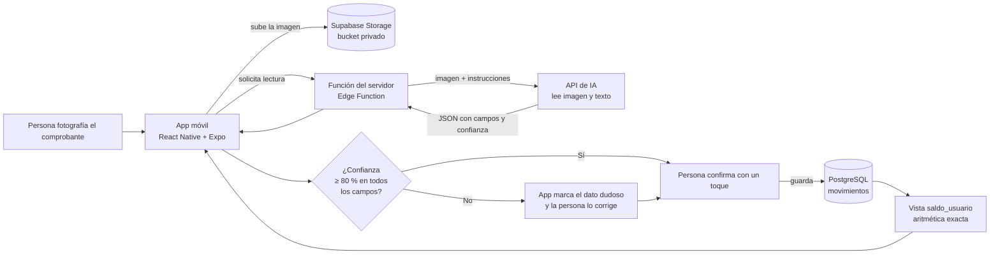

# Arquitectura de CUADRA

## Flujo principal

## Dónde interviene la IA

| Paso | Entra a la IA | Sale de la IA |
|---|---|---|
| Lectura del comprobante | Foto de la boleta, voucher o transferencia | Tipo, comercio, fecha, monto y categoría sugerida |
| Evaluación de la lectura | La misma foto | Confianza (0 a 1) por cada campo |

La IA **no** calcula el saldo ni guarda datos por sí sola.

## Decisiones

- **La clave de la IA vive en el servidor.** La app nunca la contiene; llama a una función que consulta la API.
- **Nada se guarda sin confirmación** de la persona (reduce el riesgo de lecturas erróneas).
- **Saldo exacto:** se calcula con SQL, no con IA.
- **Privacidad:** seguridad a nivel de fila en todas las tablas; bucket de imágenes privado con una carpeta por usuario. Las imágenes pueden descartarse tras la lectura exitosa.
- **Umbral de confianza de 80 %:** valor inicial; se ajustará con las pruebas.
- **Duplicados:** antes de guardar se consulta `posible_duplicado` (mismo comercio, fecha y monto).

## Modelo de datos

- `categorias`: lista compartida de categorías de gasto e ingreso.
- `movimientos`: un registro por gasto o ingreso (usuario, tipo, comercio, fecha, monto, categoría, origen, confianza, imagen).
- `saldo_usuario` y `gasto_mensual_por_categoria`: vistas que alimentan la pantalla de inicio y el gráfico.

El esquema completo está en `supabase/migrations/0001_init.sql`.

## Qué queda fuera del MVP

Conexión directa con bancos, predicciones o consejos de inversión, y cuentas compartidas entre varias personas.
